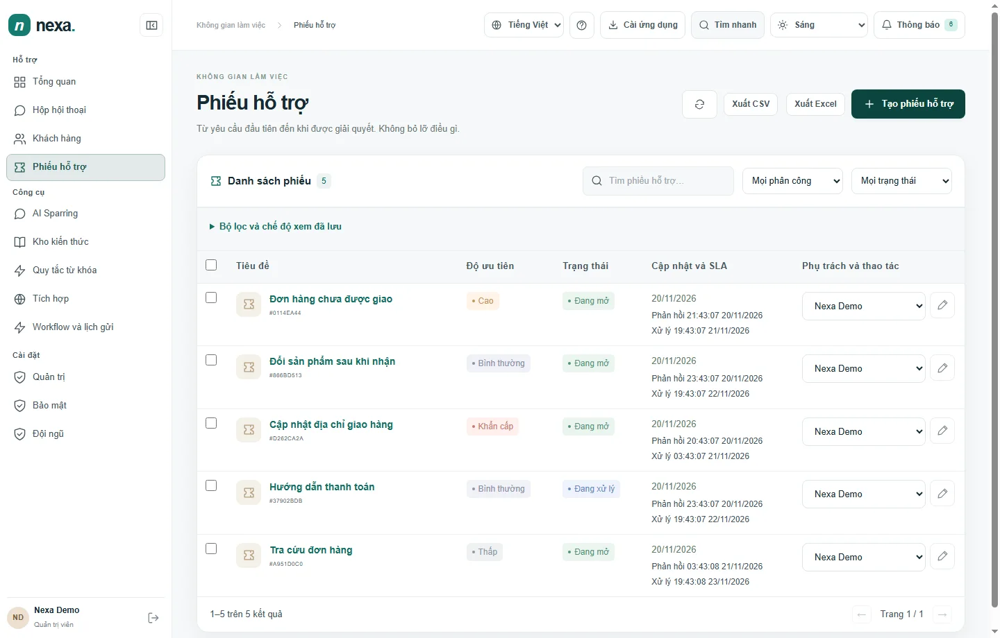
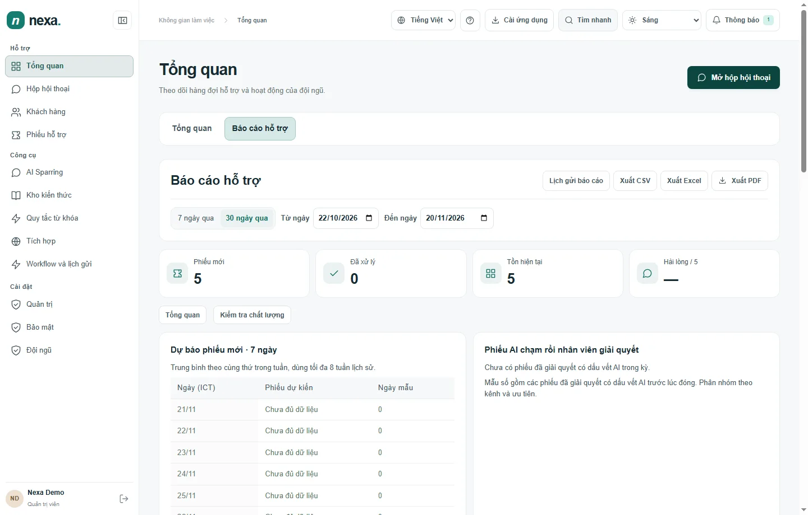
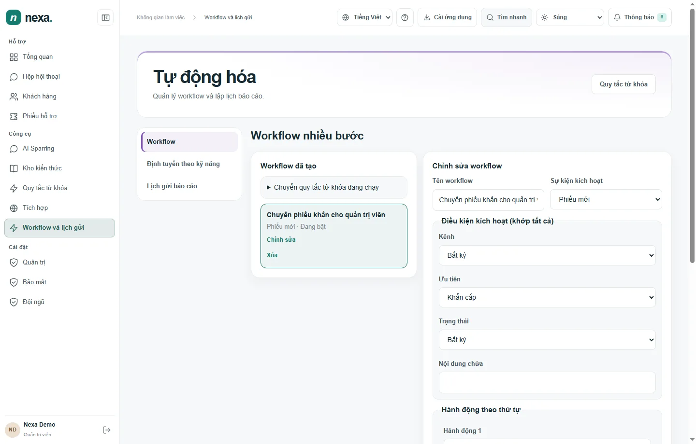
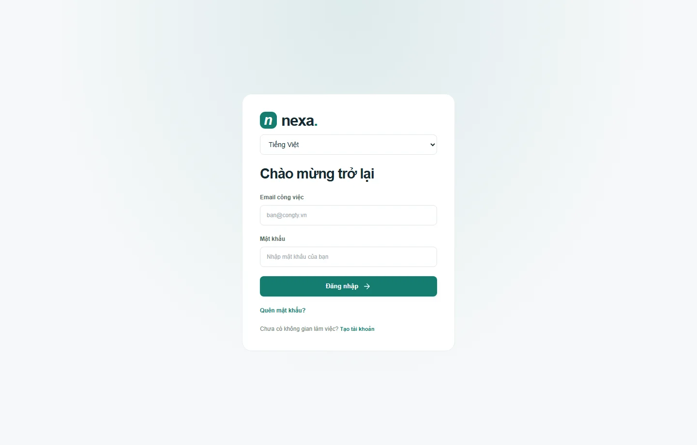

<p align="center">
  
</p>

<h1 align="center">Nexa · Business Automation</h1>

<p align="center">Nền tảng chăm sóc khách hàng và tự động hóa quy trình cho doanh nghiệp.</p>

<p align="center">
  <a href="https://nexa-web-55cq.onrender.com"><strong>Mở Nexa trên web</strong></a> ·
  <a href="#hình-ảnh-giao-diện">Hình ảnh giao diện</a> ·
  <a href="#chạy-trên-máy-cá-nhân">Chạy local</a>
</p>

> **Đang phát triển** · Bản web dùng thử đã được triển khai trên Render. Giao diện và tính năng tiếp tục được cập nhật.

## Giới thiệu

Nexa tập trung hồ sơ khách hàng, hội thoại và phiếu hỗ trợ vào một không gian làm việc. Đội ngũ hỗ trợ có thể phân công công việc, theo dõi thời hạn phản hồi và tự động hóa các thao tác lặp lại.

## Hình ảnh giao diện

Ảnh chụp từ bản chạy local với dữ liệu minh họa. Bấm vào ảnh để xem kích thước đầy đủ.

### Tổng quan

[](docs/screenshots/tong-quan.webp)

### Chăm sóc khách hàng

| Hộp hội thoại | Phiếu hỗ trợ |
| --- | --- |
| [](docs/screenshots/hoi-thoai.webp) | [](docs/screenshots/phieu-ho-tro.webp) |
| **Hồ sơ khách hàng** | **Báo cáo hỗ trợ** |
| [](docs/screenshots/ho-so-khach-hang.webp) | [](docs/screenshots/bao-cao.webp) |

### Kho kiến thức, tự động hóa và tích hợp

| Kho kiến thức | Workflow |
| --- | --- |
| [](docs/screenshots/kho-kien-thuc.webp) | [](docs/screenshots/workflow.webp) |
| **Kênh kết nối** | **Đăng nhập** |
| [](docs/screenshots/tich-hop.webp) | [](docs/screenshots/dang-nhap.webp) |

## Tính năng

| Nhóm | Khả năng |
| --- | --- |
| Hỗ trợ khách hàng | Quản lý hồ sơ, hội thoại, phiếu hỗ trợ, ghi chú nội bộ và câu trả lời mẫu. |
| Kênh liên lạc | Widget chat cập nhật trực tiếp qua SSE. Email gửi và nhận qua Resend khi được cấu hình. |
| Kho kiến thức và AI | Quản lý bài hướng dẫn, xuất bản bài trong trung tâm trợ giúp và dùng AI hỗ trợ soạn phản hồi khi cấu hình OpenAI. |
| Tự động hóa | Thiết lập workflow theo sự kiện, điều kiện và nhánh xử lý. Lên lịch gửi báo cáo. |
| Báo cáo | Theo dõi khối lượng hỗ trợ, thời hạn SLA và mức độ hài lòng của khách hàng (CSAT). |
| Quản trị | Quản lý doanh nghiệp, tài khoản owner và agent, phiên đăng nhập và nhật ký hoạt động. |

## Công nghệ và cấu trúc

| Thành phần | Công nghệ và vai trò |
| --- | --- |
| [BACKEND](BACKEND/) | API và nghiệp vụ viết bằng Go. Lưu dữ liệu bằng JSON hoặc PostgreSQL. |
| [FRONTEND](FRONTEND/) | Giao diện tiếng Việt dùng Next.js, React, TypeScript và Tailwind CSS. |
| [compose.yaml](compose.yaml) | Khởi chạy frontend, backend và PostgreSQL cho môi trường local. |

## Chạy trên máy cá nhân

Nếu chưa có mã nguồn, chạy các lệnh sau trong thư mục bạn muốn lưu dự án. Nếu đã có mã nguồn, mở terminal tại thư mục gốc của dự án.

```powershell
git clone https://github.com/thankiemsama/Business-Automation.git
cd Business-Automation
```

### Docker Compose

Cần Docker và Docker Compose. Từ thư mục gốc, chạy:

```powershell
docker compose up --build
```

Mở [http://127.0.0.1:3000](http://127.0.0.1:3000).

### Go và Node.js

Cần Go 1.24 trở lên và Node.js 24. Mở hai terminal tại thư mục gốc của dự án.

Chạy API trong terminal thứ nhất.

```powershell
cd BACKEND
go run ./cmd/api
```

API mặc định nghe tại `http://127.0.0.1:8080` và lưu dữ liệu bằng JSON nếu chưa cấu hình `DATABASE_URL`. Kiểm tra API qua [http://127.0.0.1:8080/healthz](http://127.0.0.1:8080/healthz).

Chạy giao diện trong terminal thứ hai.

```powershell
cd FRONTEND
npm ci
npm run dev
```

Mở [http://localhost:3000](http://localhost:3000).

Với cả hai cách chạy, chọn **Tạo tài khoản** để tạo doanh nghiệp và tài khoản chủ doanh nghiệp. Sau khi đăng nhập, vào **Đội ngũ** để thêm nhân viên.

## Bật email và thông báo đẩy

| Tính năng | Cấu hình backend |
| --- | --- |
| Gửi email, báo cáo định kỳ và thư khảo sát CSAT | Đặt `RESEND_API_KEY` và `EMAIL_FROM` đã xác minh trên Resend. Đặt `APP_ORIGIN` theo URL frontend để liên kết CSAT mở đúng địa chỉ. Docker Compose đã đặt origin local. |
| Nhận email qua Resend | Cấu hình biến môi trường dành cho thư đến và webhook `email.received` theo [hướng dẫn vận hành](OPERATIONS.md#zalo-oa-whatsapp-và-resend-inbound). Resend cần một endpoint HTTPS có thể truy cập từ bên ngoài. |
| Web Push | Đặt `VAPID_PUBLIC_KEY`, `VAPID_PRIVATE_KEY` và `VAPID_SUBJECT`. Trên trình duyệt hỗ trợ Web Push, mở **Thông báo → Bật Web Push** rồi cấp quyền. |

Với Docker Compose, đặt các biến trên trong tệp `.env` ở thư mục gốc rồi chạy lại `docker compose up -d`. Khi chạy trực tiếp, đặt biến bằng `$env:TÊN_BIẾN = 'giá-trị'` trong terminal chạy Go rồi khởi động lại API. Với cấu hình local mặc định, dùng `http://localhost:3000` làm `APP_ORIGIN` khi chạy trực tiếp. Giữ khóa thật trong môi trường local hoặc kho bí mật.

## Tài liệu

- [Backend](BACKEND/README.md) — cấu hình lưu trữ, API và kiểm thử.
- [Frontend](FRONTEND/README.md) — cấu hình môi trường và kiểm tra giao diện.
- [Vận hành và tích hợp](OPERATIONS.md) — chat, email, OpenAI, workflow và các tùy chọn quản trị.
