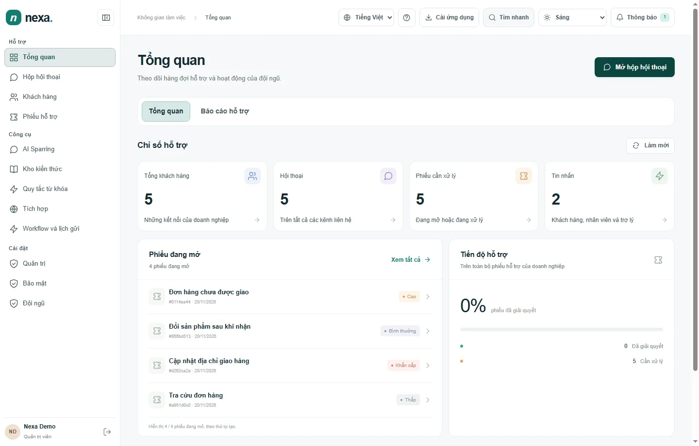
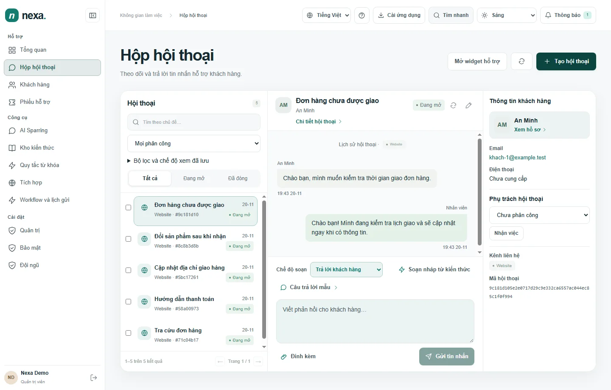
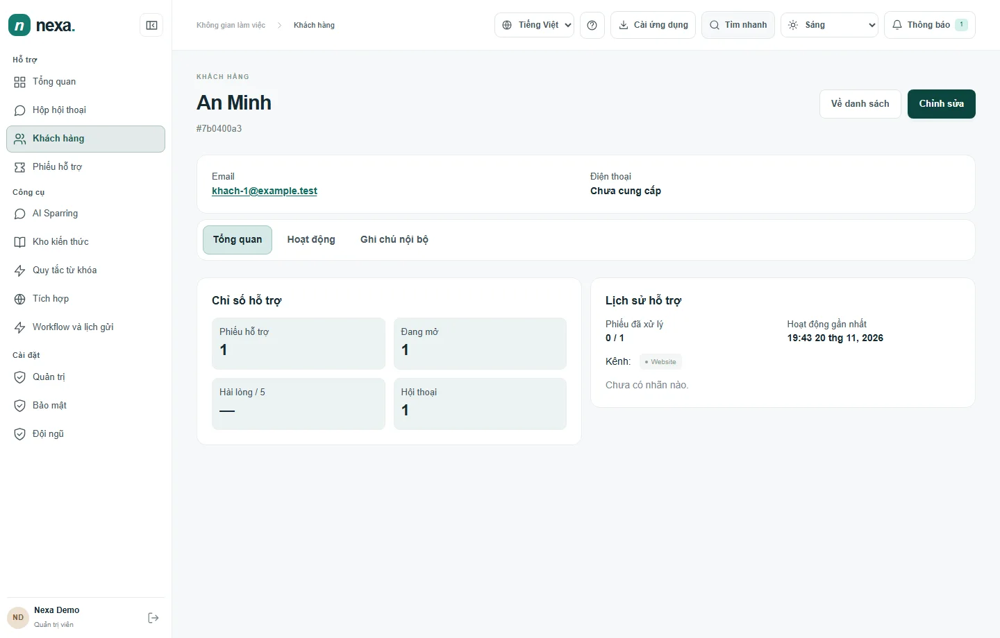
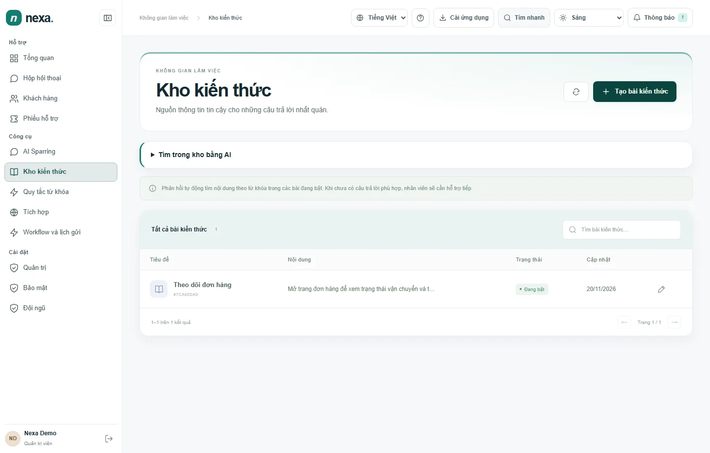
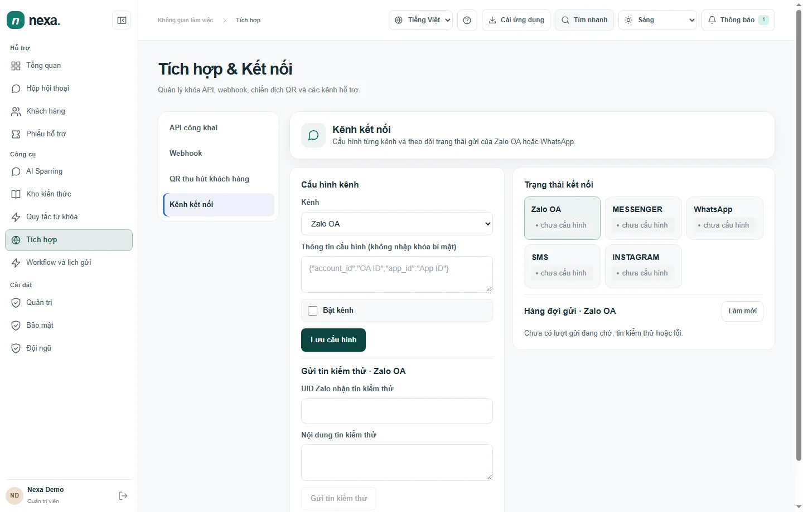

<p align="center">
  
</p>

<h1 align="center">Nexa — Customer Care & Business Automation Platform</h1>

<p align="center">
  <a href="https://nexa-web-55cq.onrender.com"><strong>Live demo</strong></a> ·
  <a href="#screenshots">Screenshots</a> ·
  <a href="#quick-start">Quick start</a> ·
  <a href="#demo-data">Demo data</a>
</p>

> **In development** — A live trial instance is hosted on Render. Features and the UI are still being updated.

---

## What is Nexa?

Nexa brings customer profiles, conversations, and support tickets into one workspace. Support teams can assign work, track response deadlines (SLA), and automate repetitive tasks — all from a single dashboard.

### Core features

| Area | What you can do |
| --- | --- |
| Customer support | Manage customer profiles, conversations, tickets, internal notes, and canned replies. |
| Communication channels | Live chat widget over SSE. Send/receive email through Resend when configured. |
| Knowledge base & AI | Curate help articles, publish them to a help center, and use AI to draft replies (when OpenAI is configured). |
| Automation | Build event → condition → action workflows. Schedule report delivery. |
| Reporting | Track support volume, SLA deadlines, and customer satisfaction (CSAT). |
| Administration | Manage the organization, owner/agent accounts, login sessions, and activity logs. |

### Tech stack

| Component | Technology |
| --- | --- |
| [BACKEND/](BACKEND/) | Go API with JSON or PostgreSQL persistence |
| [FRONTEND/](FRONTEND/) | Next.js, React, TypeScript, Tailwind CSS |
| [compose.yaml](compose.yaml) | Docker Compose setup for frontend, backend, and PostgreSQL |

---

## Screenshots

Captured from a local instance running demo data. Click any image to view it full size.

### Overview

[](docs/screenshots/tong-quan.webp)

### Customer care

| Conversation inbox | Support tickets |
| --- | --- |
| [](docs/screenshots/hoi-thoai.webp) | [](docs/screenshots/phieu-ho-tro.webp) |
| **Customer profile** | **Support reports** |
| [](docs/screenshots/ho-so-khach-hang.webp) | [](docs/screenshots/bao-cao.webp) |

### Knowledge base, automation & integrations

| Knowledge base | Workflows |
| --- | --- |
| [](docs/screenshots/kho-kien-thuc.webp) | [](docs/screenshots/workflow.webp) |
| **Channel integrations** | **Sign in** |
| [](docs/screenshots/tich-hop.webp) | [](docs/screenshots/dang-nhap.webp) |

---

## Quick start

If you don't have the source yet, clone it first:

```powershell
git clone https://github.com/thankiemsama/Business-Automation.git
cd Business-Automation
```

### Option 1 — Docker Compose (recommended)

Requires Docker and Docker Compose. From the project root:

```powershell
docker compose up --build
```

Then open [http://127.0.0.1:3000](http://127.0.0.1:3000).

### Option 2 — Go + Node.js

Requires Go 1.24+ and Node.js 24. Open **two terminals** in the project root.

**Terminal 1 — API server:**

```powershell
cd BACKEND
go run ./cmd/api
```

The API listens on `http://127.0.0.1:8080` and stores data in JSON when `DATABASE_URL` is not set. Check its status at [http://127.0.0.1:8080/readyz](http://127.0.0.1:8080/readyz).

**Terminal 2 — Frontend:**

```powershell
cd FRONTEND
npm ci
npm run dev
```

Then open [http://localhost:3000](http://localhost:3000).

### First login

With either setup:

1. Click **Create account** to create a new organization and owner account.
2. After signing in, go to **Team** to add staff members.

---

## Demo data

To load the fixed **E-commerce** demo dataset (deterministic — safe to re-run), use the seed script:

```powershell
# Local (Go API running on 127.0.0.1:8080)
cd BACKEND
.\scripts\seed-demo.ps1
```

On the **Render** instance, the Go API only listens on loopback inside the container, so run the seed from your machine through the web BFF:

```powershell
.\scripts\seed-demo.ps1 -Mode bff -BaseUrl https://<your-domain>.onrender.com
```

The `bff` mode automatically sends the correct `Origin` header and keeps the BFF's HttpOnly session cookie. Running it multiple times never creates duplicates.

| Role | Email | Password | Permissions |
| --- | --- | --- | --- |
| Owner | `owner@nexa.local` | `NexaDemo!2026` | Full access + demo data |
| Agent | `agent@nexa.local` | `NexaDemo!2026` | Receive and handle tickets |

**What the demo dataset contains** (E-commerce sample): 8 customer profiles, 5 KB articles (refunds, shipping, COD, exchanges, promotions), 3 keyword automations, 5 order conversations, 2 support tickets (1 high-priority), 2 workflow rules (auto-create ticket by keyword + stale-ticket reminder), and 2 AI sparring scenarios. Use `-Password` to change the password on public instances.

The older `scripts/demo.ps1` generates random emails and is no longer recommended for demo pitches.

> **Note:** On public instances with real Resend, the first seed run leaves the new owner in "email confirmation pending" — the seed stops with instructions to open the `/account/verify` link. To skip this on demo instances, set `NEXA_AUTO_CONFIRM_EMAIL=true` (demo only, never in production).

---

## Enabling email & push notifications

| Feature | Backend configuration |
| --- | --- |
| Outbound email (reports, CSAT surveys) | Set `RESEND_API_KEY` and `EMAIL_FROM` with a verified Resend domain. Set `APP_ORIGIN` to the frontend URL so CSAT links resolve correctly. Docker Compose already sets a local origin. |
| Inbound email via Resend | Configure the inbound-email env vars and the `email.received` webhook per the [operations guide](OPERATIONS.md#zalo-oa-whatsapp-và-resend-inbound). Resend requires an HTTPS endpoint reachable from the internet. |
| Web Push | Set `VAPID_PUBLIC_KEY`, `VAPID_PRIVATE_KEY`, and `VAPID_SUBJECT`. In a Web Push–capable browser, open **Notifications → Enable Web Push** and grant permission. |
| Email confirmation on signup | Enabled automatically when `RESEND_API_KEY` + `EMAIL_FROM` + `APP_ORIGIN` are set: new owners must click a one-time link (valid 30 minutes) before first login. Demo instances: set `NEXA_AUTO_CONFIRM_EMAIL=true` to skip. |
| MFA (TOTP) | Set `NEXA_SECURITY_KEY` (32 bytes, base64 — generate with `node -e "console.log(require('crypto').randomBytes(32).toString('base64'))"`). Without it, MFA endpoints return 503. |
| CAPTCHA (optional) | Create a Cloudflare Turnstile key pair, set `NEXA_TURNSTILE_SECRET`, and build the image with `NEXT_PUBLIC_NEXA_TURNSTILE_SITE_KEY`. The widget appears on the sign-in / sign-up / forgot-password screens. If neither variable is set, CAPTCHA is off. |

**How to apply the variables:**

- **Docker Compose** — put the variables in a `.env` file at the project root, then run `docker compose up -d` again.
- **Running directly** — set them in the Go terminal (`$env:VARIABLE = 'value'`) and restart the API. For default local configuration use `http://localhost:3000` as `APP_ORIGIN`.

Keep real keys in local environment variables or a secrets vault — never commit them.

---

## Project layout

```text
BACKEND/    Go API, services, repositories, demo scripts
FRONTEND/   Next.js application (App Router, TypeScript, Tailwind)
docs/       Screenshots and security audit reports
compose.yaml / compose.private.yaml   Docker setups
OPERATIONS.md   Operations & integration guide (chat, email, OpenAI, workflows)
```

Sub-project docs:

- [Backend](BACKEND/README.md) — storage configuration, API reference, and tests.
- [Frontend](FRONTEND/README.md) — environment configuration and UI checks.
- [Operations & integrations](OPERATIONS.md) — chat, email, OpenAI, workflows, and admin options.
